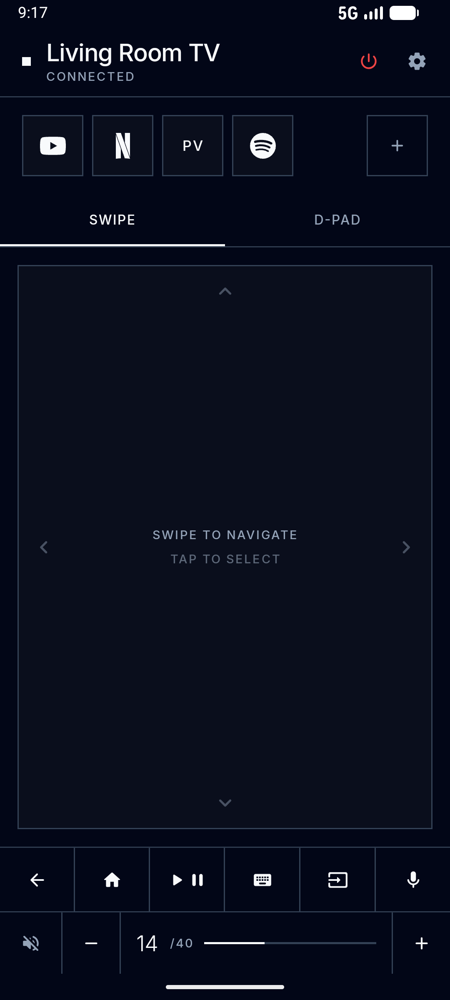
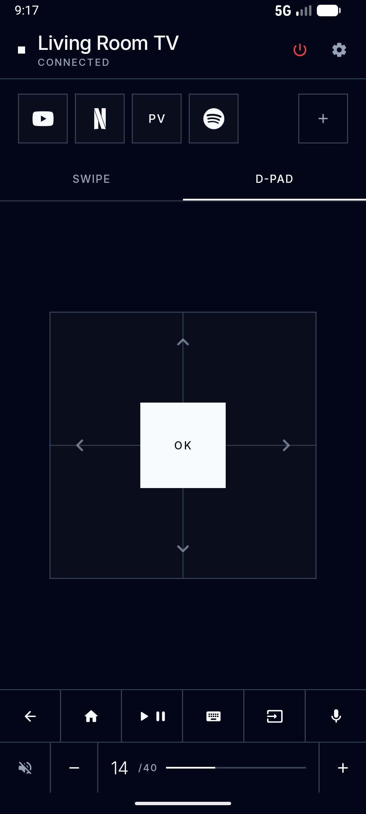
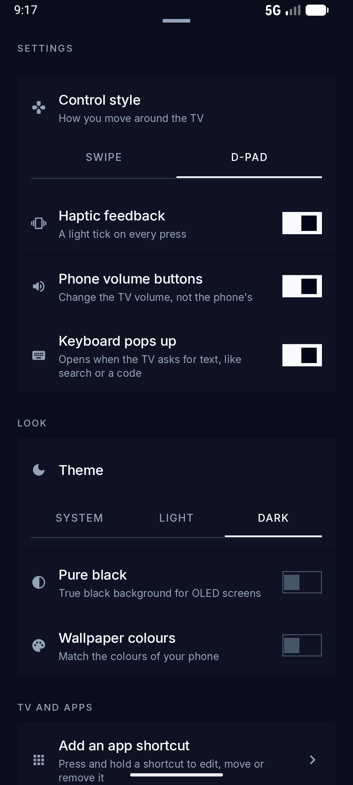
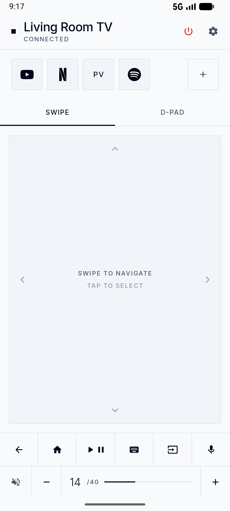

# Shield Remote — Swiss control-panel design system

A fork of [souravkl11/android-tv-remote](https://github.com/souravkl11/android-tv-remote), restyled
with the **ui-ux-pro-max** skill. Protocol, pairing, discovery and key handling are untouched; the
package is now `com.shieldremote.app`.

| Swipe | D-pad | Settings | Light |
| --- | --- | --- | --- |
|  |  |  |  |

## How the direction was chosen

`ui-ux-pro-max` was queried in the skill's three modes; only verified matches were kept:

| Query | Result | Used? |
| --- | --- | --- |
| `"tv remote control media entertainment dark" --design-system` | Feature-Rich Showcase + Vibrant & Block-based + rose palette | **No** — landing-page pattern, wrong for a native utility |
| `"minimal dark utility instrument" --domain style` | **Minimalism & Swiss Style** (active, dark supported, low access risk) | Yes |
| `"swiss monochrome dark high contrast" --domain color` | **Digital Signage / Kiosk** — `#020617` canvas, `#EF4444` accent | Yes |
| `"swiss geometric sans technical interface" --domain typography` | **Minimal Swiss** — Inter, one family, weight-driven | Yes |
| `"media remote control utility app" --domain product` | Social Media App / Telemedicine | **No** — no remote-control row in the catalogue |

The style's own constraints were followed literally: `--border-radius: 0px`, `--shadow: none`,
single accent, no gradients, 200–250ms transitions.

## Tokens

`ui/theme/Color.kt` — dark (default) and light. There is exactly **one** accent.

| Role | Dark | Light |
| --- | --- | --- |
| background / surface | `#020617` | `#F8FAFC` |
| surfaceContainer (rows) | `#0E1223` | `#E8ECF1` |
| surfaceContainerLow (pads) | `#0A0E1C` | `#F1F5F9` |
| onSurface (ink) | `#F8FAFC` | `#020617` |
| onSurfaceVariant | `#94A3B8` | `#475569` |
| outlineVariant (rules) | `#334155` | `#E2E8F0` |
| **accent = tertiary/error** | **`#EF4444`** | `#DC2626` |

`ui/theme/Type.kt` — **Inter** (bundled in `res/font`, OFL — see `LICENSE-Inter.txt`), one family.
Light weights for large type, Medium for structure, `+1.6sp` tracking on 11sp labels.
`ui/theme/Theme.kt` — every shape is `0.dp`. No corner radius exists in the app.
`ui/theme/Motion.kt` — springs with `dampingRatio = 1f` so nothing overshoots; 180–260ms.

## Rules the UI obeys

1. **Structure is a 1dp rule.** `Rule()` / `CellRule()` in `components/Expressive.kt`. Sections are
   separated by rules, never by cards, elevation or background swaps.
2. **Keys are ghost squares.** 46dp, no fill, no border at rest; a press shrinks 3% and shows a
   ripple. 44dp minimum touch target everywhere.
3. **The accent means one thing.** Red = power, mute state, voice-in-progress, failure. Nothing else
   is coloured; app tiles are monochrome on purpose.
4. **State is text.** Connection state is an 11sp uppercase label, volume is a numeric readout
   (`14 / 40` with a 2dp bar) — not a slider with a thumb.
5. **Motion is mechanical.** No bounce, no morphing shapes, no scale-in from nothing.

## Component map

| File | Change |
| --- | --- |
| `TopBar.kt` | 8dp status square, name + uppercase state, red power, then a rule. |
| `AppStrip.kt` | Monochrome 56dp tiles with 1dp borders; `+` is a bordered square. |
| `ModeSwitch.kt` | Full-width tab bar: equal cells, full-cell 2dp underline, rule beneath. |
| `SwipePad.kt` | Square panel; hairline crosshair, corner-bracket contact mark, square tap pulse. |
| `DPad.kt` | Square panel with a 1dp cross and a solid 96dp ink square for OK. |
| `ControlDeck.kt` | Two ruled strips of equal cells (nav/typing, then volume with readout). |
| `ConnectionStage.kt` | Editorial: eyebrow label, light headline, 2dp progress rule, actions. |
| `SheetKit.kt` | Square sheets, hairline-separated rows, plain icons, uppercase section labels. |
| `SettingsSheet.kt` | Pill switches replaced by `SquareToggle` — the last rounded control removed. |
| `PairingSheet.kt` | Square cells, 30sp Light digits. |
| `VoicePanel.kt` | Square meter that brackets your voice; red only while listening. |

## Package

```text
namespace      com.shieldremote.app
applicationId  com.shieldremote.app        (debug: com.shieldremote.app.debug)
```

Proto `java_package` values and the checked-in generated `.java` sources were moved too, so the
protocol code lives under `com.shieldremote.app.protocol.{pairing,remote}`.

## Pre-delivery checklist (from the skill)

- [x] No emoji as icons — Material vector icons only
- [x] Touch targets ≥ 44dp (46dp keys, 48dp tab cells)
- [x] Contrast ≥ 4.5:1 — `#F8FAFC` on `#020617` ≈ 18:1; muted `#94A3B8` ≈ 7.5:1
- [x] Light and dark both designed, not inverted
- [x] Visible state change on every press (shrink + ripple + haptic)
- [x] Loading state on every async path (2dp progress rule, text labels)
- [x] Back behaviour unchanged (typing/voice interception preserved)
- [ ] `prefers-reduced-motion` equivalent: Android's "Remove animations" is not yet honoured
      (animations are 180–260ms springs, not decorative loops)

## Debug hooks used for the screenshots

```bash
adb install -r app/build/outputs/apk/debug/app-debug.apk
adb shell am start -n com.shieldremote.app.debug/com.shieldremote.app.MainActivity \
  --es demo connected      # fake connected TV, volume 14/40
adb shell am start ... --es demo idle          # disconnected stage
adb shell am start ... --es demo pairing       # needs-pairing stage
adb shell am start ... --es open settings      # opens a sheet for UI review
```
