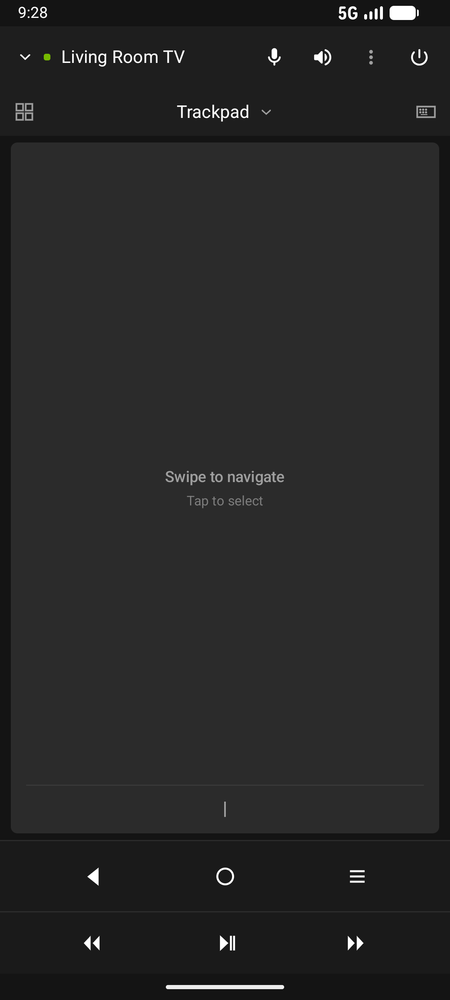
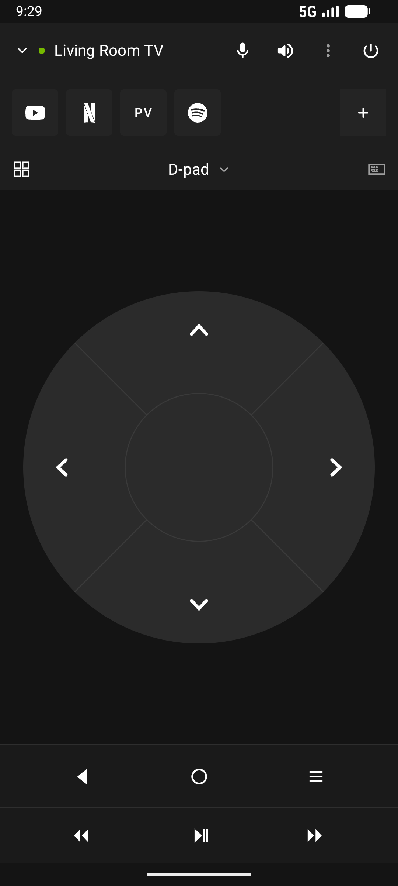
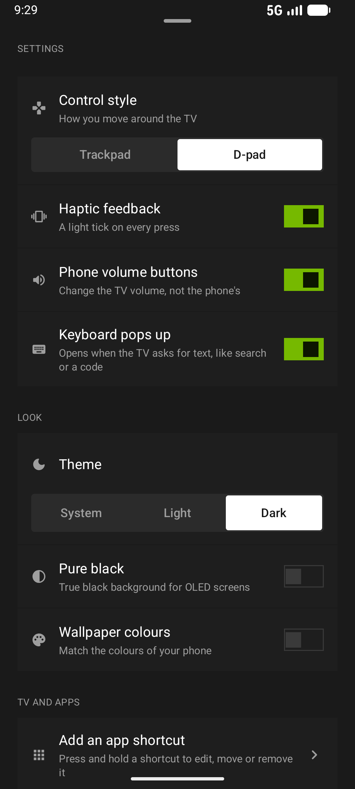
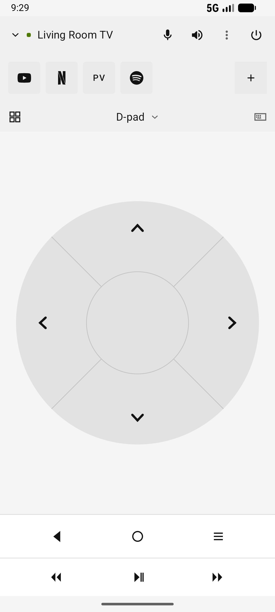

# Shield Remote — design notes

The visual language is modelled on **NVIDIA's official SHIELD TV remote app**
(`com.nvidia.shield.remote`), studied from its Play Store screenshots. No assets, icons or fonts
were copied — the layout, grey stack and icon geometry are reproduced from scratch in Compose.

| Trackpad | D-pad | Apps drawer | Settings | Light |
| --- | --- | --- | --- | --- |
|  |  |  |  |  |

## What the reference looks like

Three flat bars, one slab, two key rows:

```text
┌───────────────────────────────────────┐
│ ⌄  ● Living Room TV    🎤 🔊 ⋮ ⏻      │  56dp, #1E1E1E
├───────────────────────────────────────┤
│ ▦            Trackpad ⌄          ⌨    │  44dp, #1E1E1E
├───────────────────────────────────────┤
│                                       │
│           #2B2B2B slab                │  fills, 6dp radius
│                                       │
│  ───────────────────────────────      │  click strip rule
│                 |                     │  caret
├───────────────────────────────────────┤
│      ◁        ◯        ☰              │  64dp nav row
├───────────────────────────────────────┤
│      ◀◀      ▶❙❙      ▶▶             │  56dp transport row
└───────────────────────────────────────┘
```

D-pad mode replaces the slab with a large circle: an inner ring for OK, four chevrons on the
cardinals, hairline separators on the diagonals.

## Tokens

`ui/theme/Color.kt`

| Role | Dark (default) | Light |
| --- | --- | --- |
| background | `#141414` | `#F5F5F5` |
| surfaceContainer (bars) | `#1E1E1E` | `#F0F0F0` |
| surfaceContainerLow (key rows) | `#1A1A1A` | `#FFFFFF` |
| surfaceContainerHighest (trackpad, D-pad) | `#2B2B2B` | `#E2E2E2` |
| onSurface | `#FFFFFF` | `#121212` |
| onSurfaceVariant | `#9E9E9E` | `#616161` |
| outline / rules | `#3A3A3A` | `#C2C2C2` |
| **accent (primary / tertiary)** | **`#76B900`** | `#4F7A00` |
| error | `#E5484D` | `#C62828` |

`ui/theme/Type.kt` — the platform face (Roboto), regular weight for almost everything, medium only
for the device name and button labels. Small positive tracking, no negative tracking on headings.
`ui/theme/Theme.kt` — 2 / 4 / 6 / 8 / 12dp radii; the trackpad is 6dp, buttons 4dp, the D-pad is a
circle.
`ui/theme/Motion.kt` — 180–260ms springs, no overshoot.

## Rules

1. **Three greys, no shadows, no gradients.** Everything is a flat surface from the stack above.
2. **Green means live.** Only the connected dot, the selected menu item and the primary action are
   green. Everything else is white, grey or red-for-failure.
3. **Hairlines carry the structure.** `Rule()` between rows, one divider inside the trackpad for
   its click strip.
4. **Glyphs are drawn, not borrowed.** `ui/components/Glyphs.kt` reproduces the bare triangles,
   hollow circle, three bars and double-triangles on a 24-unit grid, because Material's
   arrow-with-shaft icons clash with the reference.
5. **The pad is the page.** No cards, no headers above it, no decorative chrome.

## Deviations from the reference (deliberate)

| Change | Why |
| --- | --- |
| **Apps drawer** behind the ▦ key in the mode bar | Upstream feature the SHIELD app doesn't have; hidden by default so the screen stays identical when unused. |
| **Settings** as a `⋮` overflow in the top bar | The reference has no settings entry; the app needs one. |
| **Green status dot** next to the device name | Replaces a text state label; the reference shows none. |
| **TV input** moved into Settings | The reference has no input key and no on-screen volume rocker. |
| **Volume** left to the phone's hardware keys (setting is on by default) | The reference only exposes mute. |
| **Light theme** | The reference is dark-only; the palette is designed rather than inverted. |

## Pre-delivery checklist

- [x] Icons are drawn/vector, never emoji
- [x] Touch targets ≥ 44dp (44dp bar keys, 72×56 deck keys, 48dp tiles)
- [x] Contrast ≥ 4.5:1 (`#FFFFFF` on `#141414` ≈ 17:1; `#9E9E9E` on `#141414` ≈ 6.4:1)
- [x] Every press has feedback (3% shrink, ripple, haptic)
- [x] Async paths label themselves ("Connecting", 2dp progress rule)
- [x] Back gesture behaviour unchanged (typing/voice interception preserved)
- [ ] Android's "Remove animations" is not honoured yet

## Debug hooks used for the screenshots

```bash
adb install -r app/build/outputs/apk/debug/app-debug.apk
adb shell am start -n com.shieldremote.app.debug/com.shieldremote.app.MainActivity \
  --es demo connected      # fake connected TV
adb shell am start ... --es demo idle          # disconnected stage
adb shell am start ... --es demo pairing       # needs-pairing stage
adb shell am start ... --es open settings      # opens a sheet for UI review
```
