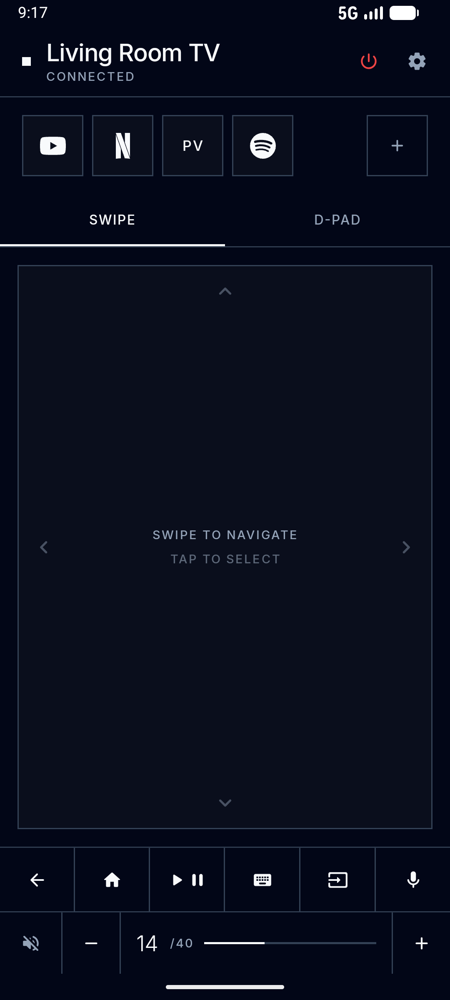
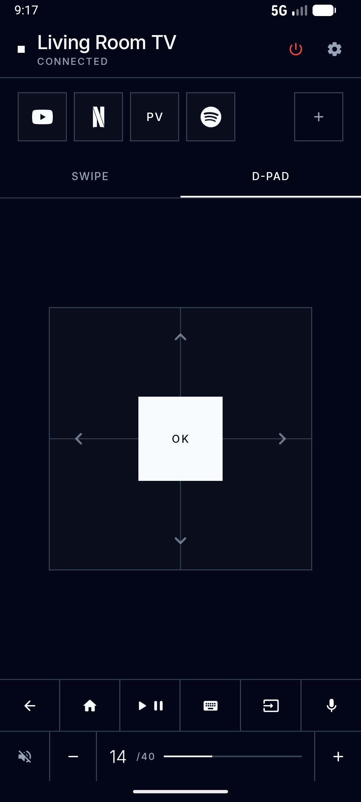
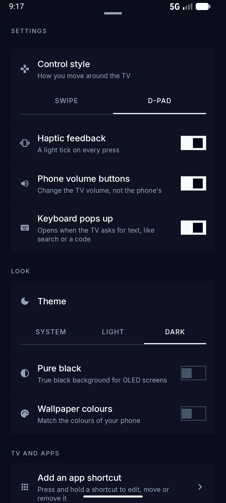
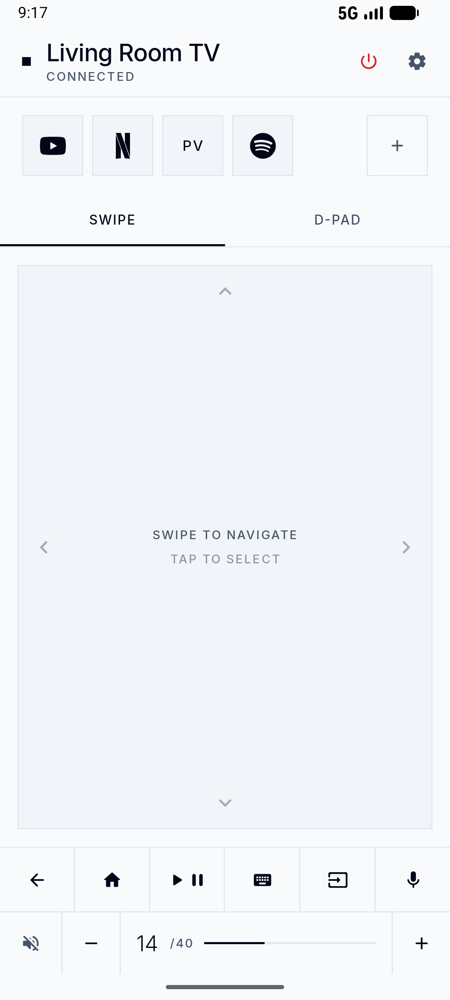

# Shield Remote

An Android remote for NVIDIA SHIELD / Android TV, over Wi-Fi. No ads, no tracking, no root, no ADB.

This is a personal fork of [souravkl11/android-tv-remote](https://github.com/souravkl11/android-tv-remote),
restyled with the **ui-ux-pro-max** skill and re-published under a new application id. The protocol,
pairing, discovery and key handling are the upstream implementation; the visual layer, the app name
and the package are not.

| Swipe | D-pad | Settings | Light theme |
| --- | --- | --- | --- |
|  |  |  |  |

## Features

- **Android TV Remote Protocol v2** — Google's own TLS protocol, the one the Google TV app speaks.
  Standard on-screen PIN pairing; nothing to enable on the TV.
- **Network discovery** — TVs announce themselves over mDNS (`_androidtvremote2._tcp`). A manual
  **Connect by IP address** field covers static IPs and VLANs where mDNS does not cross.
- **Two control styles** — a swipe pad (swipe to move, tap to select, hold for a long press) or a
  classic D-pad. Long-press, key repeat and haptics work in both.
- **Type on the TV** — text goes straight into TV search boxes and password fields, character by
  character, with backspace repeat.
- **Voice search** — 8 kHz PCM streamed to the TV.
- **App shortcuts** — one-tap launch for the apps installed on the TV, ordered and edited by hand.
- **Volume** — on-screen rocker plus optional phone hardware volume keys.
- **Quick Settings tile** — jump into the remote from the notification shade.
- **Themes** — dark, light, system, optional pure black for OLED, optional wallpaper colours.

## Requirements

**Phone**

| | |
| --- | --- |
| Android | 7.0 (API 24) – 17 (API 37) |
| Network | Same Wi-Fi/LAN as the TV |

**TV**

The TV needs Google's **Android TV Remote Service** (`com.google.android.tv.remote.service`) with
protocol v2 support. It is preinstalled on most Android TV devices.

For NVIDIA SHIELD that means **SHIELD Experience 9 / Android 11 or newer** — SHIELD Experience 9.0
brought Android 11 to every SHIELD model, including the 2015 and 2017 units. On Experience 8.2.3
(Android 9) the service is v4 and v2 pairing will fail; force-stop that service and clear its
storage if it misbehaves, or reinstall it from the Play Store.

Fire TV devices do not work: they do not ship the Remote Service and it cannot be sideloaded.

## Install

Grab an APK from `app/build/outputs/apk/` after building, or from this repo's releases:

```bash
adb install -r app/build/outputs/apk/release/app-release.apk
```

Then: open the app → pick the TV → type the 6-character code shown on the TV.

**The APKs in this repo are signed with the Android debug keystore.** They install and run fine for
personal use, but they are not Play Store builds. Generate a release keystore before publishing
anything.

On **Android 16 and newer** the first launch shows a system *Local network access* prompt. It is the
OS asking for permission to browse the LAN for the TV, not something the app invented — without it
only manual IP entry works.

## Build

Prerequisites: Android SDK with **platform 37**, and **JDK 17 or newer**. Android Studio's bundled
JBR works, which means no separate JDK install is needed.

```powershell
# Windows PowerShell
$env:JAVA_HOME = "C:\Program Files\Android\Android Studio\jbr"
$env:ANDROID_HOME = "$env:LOCALAPPDATA\Android\Sdk"
.\gradlew.bat assembleRelease
```

```bash
# macOS / Linux
export JAVA_HOME="/Applications/Android Studio.app/Contents/jbr/Contents/Home"
export ANDROID_HOME="$HOME/Android/Sdk"
./gradlew assembleRelease
```

Output: `app/build/outputs/apk/release/app-release.apk`. Use `assembleDebug` for the debug build,
which installs alongside the release one (`…​.debug` suffix) and exposes the UI-review hooks below.

Toolchain pinned in `gradle/libs.versions.toml` and the wrapper: Gradle 9.6.0, AGP 9.4.1,
Kotlin 2.2.10, Compose BOM 2026.02.01, `compileSdk` / `targetSdk` 37, `minSdk` 24, Java 11 target.

### UI review hooks (debug builds only)

```bash
adb shell am start -n com.shieldremote.app.debug/com.shieldremote.app.MainActivity \
  --es demo connected      # fake connected TV, volume 14/40
adb shell am start ... --es demo idle          # disconnected stage
adb shell am start ... --es demo connecting    # spinner + "Choose another TV"
adb shell am start ... --es demo pairing       # needs-pairing stage
adb shell am start ... --es open settings      # opens a sheet for UI review
```

## Package identity

```text
namespace       com.shieldremote.app
applicationId   com.shieldremote.app
debug id        com.shieldremote.app.debug
```

This fork is not a drop-in replacement for upstream: it installs as a separate app and does not
share pairing credentials with `com.ryzen.tvremote`.

## Design

The look is a Swiss control panel: **zero corner radius**, no shadows, no gradients, **one red
accent** used only for power, mute, voice-in-progress and failure, structure from 1dp rules, and
**Inter** (bundled, OFL) as the single typeface.

| Token | Dark | Light |
| --- | --- | --- |
| Canvas | `#020617` | `#F8FAFC` |
| Ink | `#F8FAFC` | `#020617` |
| Rules | `#334155` | `#E2E8F0` |
| Accent | `#EF4444` | `#DC2626` |

The direction, the rejected alternatives, the token tables and the pre-delivery checklist are
documented in **[DESIGN.md](DESIGN.md)**.

## How it works

- **Discovery** — mDNS service `_androidtvremote2._tcp` on the LAN; the TV's name comes from the
  service, and `_adb._tcp` on port 5555 means network debugging is on.
- **Pairing** — TLS on port **6467** with the 6-character code from the TV. The phone generates a
  certificate once in the Android Keystore; the TV's certificate is pinned at pairing, so the
  pairing survives restarts until the TV forgets it.
- **Control** — TLS + protocol buffers on port **6466**: keys, text, app links, voice.
- No ADB, no root, no developer options required for any of the above.

Deep links are supported through the TV's own handlers, which is how app shortcuts launch.

## Project layout

```text
app/src/main/java/com/shieldremote/app/
  MainActivity.kt              screen composition, phone volume keys
  protocol/
    AndroidTvRemoteV2Client.kt pairing + remote channels, IME, voice
    DiscoveryManager.kt        mDNS/NsdManager discovery
    KeyManagerHelper.kt        TLS context, certificate storage
    RemoteKey.kt               key enum
  ui/
    MainViewModel.kt           connection state, prefs, shortcuts
    components/                the visual layer (see DESIGN.md)
    theme/                     colour, type, shape, motion tokens
  apps/                        app shortcuts, brand glyph paths
  voice/                       MicRecorder → 8 kHz PCM
app/src/main/proto/            pairing + remote protocol definitions
```

## Troubleshooting

**No TV in the list.** Confirm both devices are on the same subnet and that mDNS is not blocked by
the router (client isolation / "AP isolation" breaks it). Type the TV's IP into *Connect by IP
address* instead. A SHIELD sometimes advertises a stale IP; the manual field bypasses that.

**Pairing fails or loops.** On the TV: Settings → Apps → Show system apps → **Android TV Remote
Service** → clear storage, then reboot the TV and pair again. Check the service exists at all — some
older SHIELD builds do not ship it.

**Power button does nothing, or the TV will not wake.** Key presses over the protocol often do not
wake a sleeping device. On a SHIELD, Settings → Remotes & accessories → **Simplified wake buttons**:
disable "wake on power and Netflix buttons only".

**Keyboard types into the wrong place.** Settings → turn off *Keyboard pops up*; some TVs show
"Use keyboard on mobile device screen" instead of their own keyboard.

**App shortcuts do nothing.** The TV only opens links its installed apps declare. Shortcuts added by
package name require the app to be installed on the TV.

## Privacy

No analytics, no ads, no third-party servers. The pairing key stays in the Android Keystore; TV
names, IPs and shortcuts stay in local SharedPreferences. The only network traffic is to your TV on
the local network — plus an optional GitHub release check, which can be ignored.

## Credits

- Upstream app: [souravkl11/android-tv-remote](https://github.com/souravkl11/android-tv-remote)
  (Apache-2.0) — protocol client, discovery, voice and shortcut implementation.
- Protocol reference: [tronikos/androidtvremote2](https://github.com/tronikos/androidtvremote2),
  the library behind Home Assistant's Android TV Remote integration.
- Design intelligence: [ui-ux-pro-max](https://github.com/nextlevelbuilder/ui-ux-pro-max-skill)
  (styles, palettes, typography, UX rules).
- Typeface: [Inter](https://rsms.me/inter/) by Rasmus Andersson, SIL Open Font License 1.1 —
  license text in [`LICENSE-Inter.txt`](LICENSE-Inter.txt).
- App logos used inside shortcut tiles are trademarks of their respective owners and are drawn only
  to label shortcuts.

## License

Apache License 2.0 — see [LICENSE](LICENSE). As a derivative of the upstream project, the original
copyright and license notices are retained.
